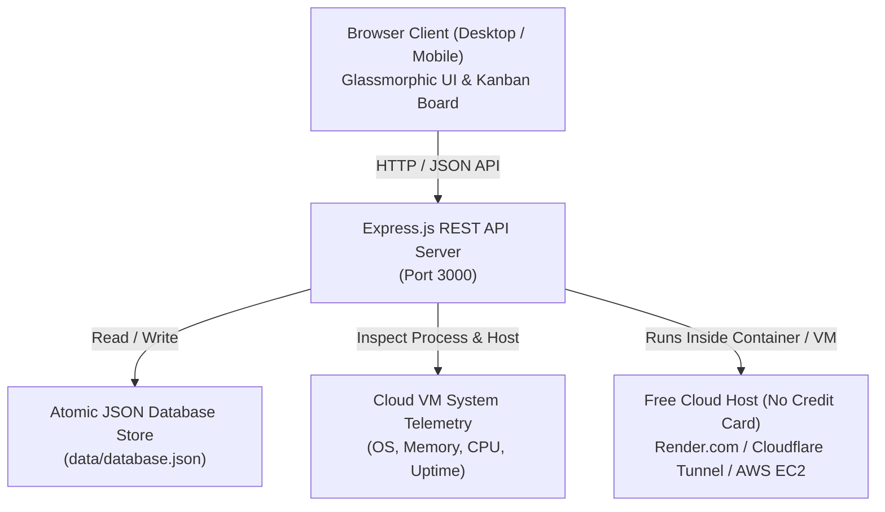

# ☁️ Cloud-Based Student Project Management System

> A collaborative, cloud-hosted university project management platform designed for engineering student teams. Built with Node.js, Express, and a responsive glassmorphic web interface.


---

## 📋 Project Overview

In university engineering and computer science courses, student project teams struggle with coordinating sprint deliverables, delegating tasks, meeting strict semester deadlines, and tracking individual member contributions.

This **Cloud-Based Student Project Management System** provides an all-in-one distributed solution where team members can:
- 📁 **Create Projects**: Organize coursework by subject, course code, milestones, and deadlines.
- 📋 **Add Tasks**: Specify rich descriptions, priority levels (Urgent 🔥, High 🔺, Medium ⚡, Low 🟢), and technical tags (Frontend, Backend, Cloud/DevOps, Database, UI/UX).
- 👥 **Assign Tasks to Members**: Delegate tasks to specific students with visual avatars, roles, and workload meters.
- ⏰ **Set Deadlines & Track Progress**: Intelligent countdown tags, with automated alerts for tasks that are **Overdue ⚠️**, **Due Today ⏰**, or **Due Soon ⏳**.
- 🔄 **Update Task Status**: Interactive drag-and-drop Kanban workflow (**To Do &rarr; In Progress &rarr; In Review &rarr; Completed**).
- 👤 **One-Click Team Member Profile Switcher**: Switch instantly between team roles (Team Lead, Frontend, Backend, UI/UX, DevOps) during demos and evaluation.
- ⚡ **Real-Time Audit Trail**: Chronological activity feed capturing every status change and assignment with timestamps.
- 📊 **Cloud VM Telemetry Dashboard**: Live monitoring of cloud virtual machine health, server uptime, CPU cores, and memory utilization.

---

## 🏛️ System Architecture



---

## 🛠️ Technology Stack

- **Backend Runtime**: Node.js 20+ LTS
- **Web Framework**: Express.js REST API
- **Data Persistence**: Portable file-based JSON storage with atomic writes, auto-backup, and seed reset
- **Frontend Core**: Semantic HTML5, Vanilla JavaScript (ES6+ Modular)
- **Styling**: Vanilla CSS3 Glassmorphism Design System (Responsive, Dark Mode, Micro-animations, Google Fonts Outfit & Inter)
- **Cloud VM & Containerization**: Docker, Docker Compose, PM2 Process Manager, Ubuntu Linux VM, Render Blueprint

---

## 🚀 Quick Start (Local Setup)

### 1. Clone or Open the Repository:
```bash
cd "CC Project"
```

### 2. Install Dependencies:
```bash
npm install
```

### 3. Start the Server:
```bash
npm start
```

### 4. Open in Browser:
```
http://localhost:3000
```

---

## 🌐 Free Cloud Deployment (Without Credit Card)

You can deploy this project for your university viva / grading **without needing a credit card** using any of these methods:

### Option A: Render.com (100% Free Web Service)
1. Push this folder to a GitHub repository.
2. Sign up on [Render.com](https://render.com) using your GitHub account (No credit card needed).
3. Click **New +** &rarr; **Web Service** &rarr; Select your repo.
4. Set Build Command: `npm install` and Start Command: `npm start`.
5. Click **Create Web Service** &mdash; your public HTTPS URL is live in ~2 minutes!

### Option B: Instant Public Cloud Tunnel (Cloudflare)
Expose your local machine or university lab computer to the global Internet with a free HTTPS URL:
```bash
npm run tunnel
```
Share the generated `https://*.trycloudflare.com` URL with your professor!

### Option C: Ubuntu Linux VM / AWS EC2
If you have an AWS EC2 instance, AWS Academy student sandbox, or Ubuntu VPS:
```bash
chmod +x setup-vm.sh
./setup-vm.sh
```
This automated script installs Node.js, PM2, configures firewall rules, and starts the system with automatic reboot recovery.

> 📖 **For complete step-by-step instructions**, see [DEPLOYMENT_GUIDE.md](file:///Users/mightmike/Uni%20Projects/CC%20Project/DEPLOYMENT_GUIDE.md).

---

## 📡 REST API Reference

| Method | Endpoint | Description |
|---|---|---|
| `GET` | `/api/health` | Cloud VM telemetry, uptime, memory & system status |
| `GET` | `/api/projects` | Get all projects with task statistics and progress % |
| `POST` | `/api/projects` | Create a new student project |
| `PUT` | `/api/projects/:id` | Update project details or deadline |
| `DELETE` | `/api/projects/:id` | Delete a project and associated tasks |
| `GET` | `/api/tasks` | Get tasks with optional filters (`projectId`, `assigneeId`, `status`, `priority`) |
| `POST` | `/api/tasks` | Create a new task with deadline and assignee |
| `PUT` | `/api/tasks/:id` | Update task status, assignee, or deadline |
| `DELETE` | `/api/tasks/:id` | Delete a task |
| `GET` | `/api/members` | Get all team members and active user ID |
| `POST` | `/api/members` | Add a new team member |
| `POST` | `/api/members/active` | Switch active member profile (1-click demo switcher) |
| `GET` | `/api/activities` | Get real-time chronological activity audit log |
| `GET` | `/api/metrics` | Summary metrics: completion rates, workload breakdown |
| `POST` | `/api/reset` | Restore demo seed data for university evaluations |

---

## 👥 Pre-Configured Student Team Profiles

For testing and demonstration, the system comes pre-loaded with sample university coursework data:
1. **Alex Rivera** - Team Lead & Cloud Architect
2. **Priya Sharma** - Full Stack Developer
3. **Jordan Chen** - Backend & DevOps Engineer
4. **Maya Patel** - UI/UX & Frontend Designer
5. **Carlos Ortiz** - QA & Database Specialist

You can also create custom team members anytime via the **Team Roster** tab.

---

## 📄 License
This project is open-source and created for university coursework and educational demonstrations.
